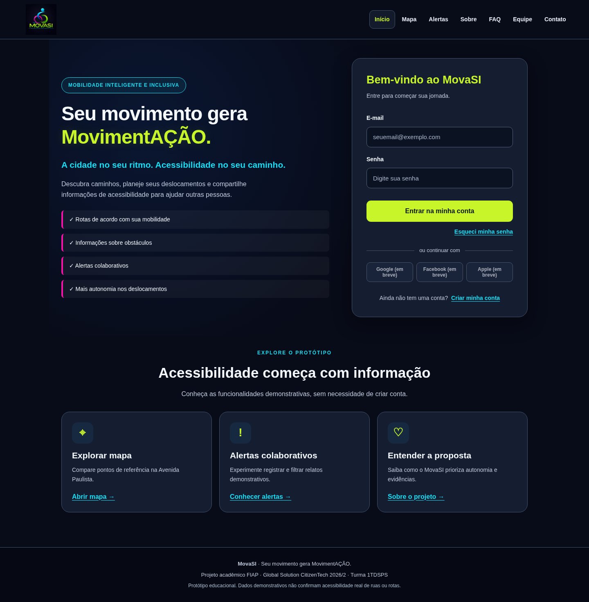
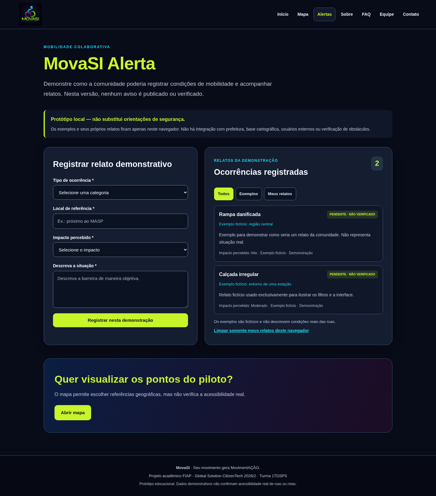

# MovaSI — Seu movimento gera MovimentAÇÃO


**Global Solution FIAP 2026/2 · CitizenTech · Front-End Design Engineering · Turma 1TDSPS**

## Descrição e objetivo

O MovaSI é uma proposta acadêmica de mobilidade inclusiva. Seu objetivo é ampliar o acesso a informações sobre deslocamentos, obstáculos e mobilidade urbana, priorizando a autonomia de pessoas com deficiência e mobilidade reduzida. Um trecho sem dados verificados **não** pode ser considerado acessível.

A demonstração explora pontos de referência da Avenida Paulista e apresenta formulários de colaboração. **Não é um serviço de navegação seguro ou de informações em tempo real.**

## Tecnologias utilizadas

- HTML5 semântico, CSS3 (incluindo `@media`) e JavaScript puro.
- Git e GitHub para versionamento do projeto.
- Leaflet 1.9.4 **somente para a visualização do mapa**, com dados cartográficos do OpenStreetMap. Carregamento online, sem substituição dos recursos fundamentais de HTML/CSS/JavaScript.
- `localStorage` para favoritos e alertas **demonstrativos** no navegador. Sem servidor, OAuth, banco de dados ou coleta centralizada.

## Páginas do projeto

1. `index.html` — apresentação, login/cadastro demonstrativos e acesso às funcionalidades.
2. `painel.html` — pontos de referência no mapa, perfil de mobilidade e favoritos locais.
3. `alertas.html` — registro e filtragem de relatos simulados (não publicados).
4. `sobre.html` — problema, solução e objetivos CitizenTech.
5. `faq.html` — perguntas frequentes e busca com JavaScript.
6. `integrantes.html` — identificação, fotografias individuais e perfis públicos da equipe.
7. `contato.html` — formulário com validações e feedback local, sem envio real.

## Estrutura de pastas

```text
MovaSI_FrontEnd_Global_Solution_2026/
├── index.html
├── painel.html
├── alertas.html
├── sobre.html
├── faq.html
├── integrantes.html
├── contato.html
├── css/
│   ├── style.css
│   ├── painel.css
│   └── componentes.css
├── js/
│   ├── main.js
│   ├── script.js
│   ├── painel.js
│   ├── alertas.js
│   ├── faq.js
│   └── contato.js
├── assets/
│   ├── logo-movasi.png
│   ├── equipe/          # fotografias individuais fornecidas pela equipe
│   └── capturas/        # capturas reais do projeto
├── IDENTIFICACAO_EQUIPE.txt
├── .gitignore
└── README.md
```

## Como visualizar

Abra `index.html` no navegador, ou utilize a extensão Live Server no VS Code. A interface é responsiva e mantém um menu de navegação consistente nas sete páginas. Para visualizar o mapa do Leaflet, é necessária conexão com a internet. As demais telas funcionam sem servidor.

## Funcionalidades em JavaScript

- Menu mobile acessível (abrir/fechar, tecla Escape e `aria-expanded`).
- Alternância visual entre login e cadastro com validações, sem registrar contas.
- Mapa de referências geográficas (sem rotas calculadas nem acessibilidade verificada).
- Destinos favoritos em `localStorage`.
- Simulação de registro, consulta e filtro de alertas locais.
- Busca de perguntas frequentes.
- Formulário de contato com validações de campos, e-mail, realce e mensagens de feedback (sem envio real).

## Identidade visual e imagens

A marca MovaSI utiliza fundo escuro e detalhes neon em ciano, verde e rosa. A imagem acima é a identidade visual do projeto.

**Capturas reais de interface em execução no navegador de testes:**





A visualização do mapa depende de conexão externa com Leaflet e OpenStreetMap; por isso, não há captura de mapa carregado neste pacote. Para validar o mapa, abra `painel.html` em um navegador conectado à internet.

## Integrantes

| Integrante | RM | Turma | GitHub | LinkedIn |
|---|---|---|---|---|
| Diane Vinha Arantes | 575041 | 1TDSPS | [@dianevinhaarantes](https://github.com/dianevinhaarantes) | [Perfil LinkedIn](https://www.linkedin.com/in/diane-arantes) |
| Gleycianne Arruda de Freitas Silva | 575040 | 1TDSPS | [@gleycifreitas](https://github.com/gleycifreitas) | [Perfil LinkedIn](https://www.linkedin.com/in/gleyci) |
| Isabella Fernandes dos Passos Prado | 574951 | 1TDSPS | [@isabellaprado25](https://github.com/isabellaprado25) | [Perfil LinkedIn](https://www.linkedin.com/in/isabellaprado20) |

## Repositório GitHub

**INSERIR LINK REAL DO REPOSITÓRIO PÚBLICO QUANDO ELE EXISTIR**

O histórico de commits deve representar alterações que realmente aconteceram durante o desenvolvimento, preferencialmente registradas pelas integrantes em suas próprias contas.

## Contato

**INSERIR UM CONTATO REAL E AUTORIZADO DA EQUIPE ANTES DA ENTREGA.** O formulário `contato.html` é demonstrativo e não envia mensagens.

## Limitações acadêmicas

Nenhuma informação mostrada neste protótipo confirma segurança ou acessibilidade de ruas e rotas. As funcionalidades de conta, contato e alertas são demonstrativas; os dados dos alertas e favoritos só ficam no navegador. O projeto Java e a modelagem Oracle são entregas complementares, sem integração ativa com este front-end.

## Uso de inteligência artificial

Ferramentas de IA foram usadas como **apoio na revisão e organização do desenvolvimento e da documentação**, com verificação e responsabilidade da equipe. A equipe deve revisar, entender e ser capaz de explicar cada funcionalidade.

---

**MovaSI — Seu movimento gera MovimentAÇÃO.**
